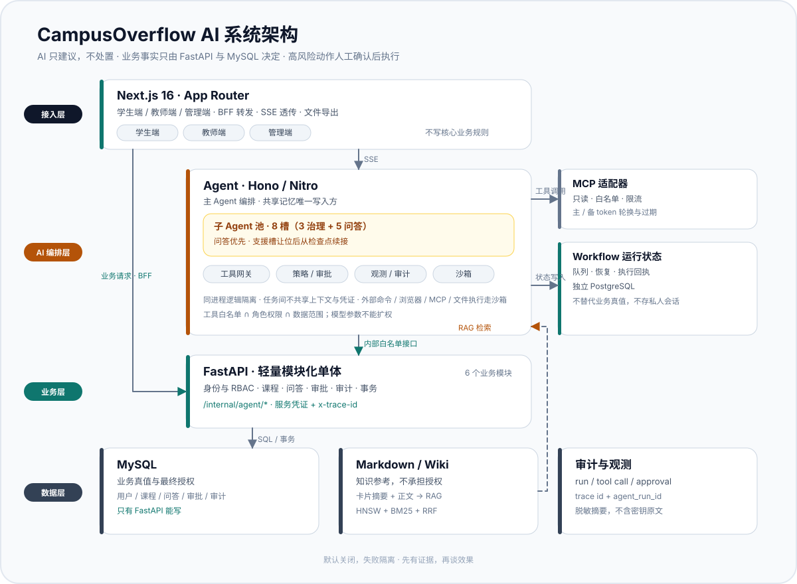

<div align="center">

# CampusOverflow AI

面向高校课程场景的 AI 问答与内容治理平台

**AI 只建议，不处置；默认关闭，失败隔离；先有证据，再谈效果。**


</div>

<p align="center">
  
</p>

它不是一个“给论坛加一个聊天框”的项目，而是一套把 AI 放进真实业务约束里的系统：课程是权限边界，业务事实只由 FastAPI 与 MySQL 决定，AI 只负责分析、检索和建议，高风险动作必须经过人工确认后由后端执行。

## 目录

- [1. 项目定位](#1-项目定位)
- [2. 系统架构](#2-系统架构)
- [3. 关键设计](#3-关键设计)
- [4. P0 架构加固](#4-p0-架构加固)
- [5. Cross-testing 对照实验](#5-cross-testing-对照实验)
- [6. 目录](#6-目录)
- [7. 本地运行](#7-本地运行)
- [8. 验证](#8-验证)
- [9. 沙箱与验证](#9-沙箱与验证)
- [10. 当前状态与限制](#10-当前状态与限制)
- [11. 文档](#11-文档)

## 1. 项目定位

| 目标 | 具体约束 |
| --- | --- |
| 业务事实唯一 | 用户、课程、问答、审批、审计只存 MySQL，只有 FastAPI 能写；Agent 不直连业务库 |
| 权限最小化 | RBAC 三角色 + 课程范围 + 助教能力位；工具白名单与数据范围取交集 |
| 风险可治理 | 隐藏、删帖、封禁等动作只生成待确认工单，人工确认后由后端复核并执行 |
| 能力可运维 | 新增能力默认关闭，具备开关、回滚、失败隔离与审计 |
| 效果可验证 | 关键设计用对照实验与配对统计验证，不用“跑通了”代替“有效” |

## 2. 系统架构

| 服务 | 职责 | 不做什么 |
| --- | --- | --- |
| Next.js | 三端页面、BFF 转发、SSE 透传、文件导出 | 不写核心业务规则 |
| FastAPI | 认证、RBAC、课程、问答、事务、审批、审计 | 不调用模型做决策 |
| Agent | 主 Agent 编排 + 子 Agent 池（3 治理 + 5 问答）、任务路由、工具调用、RAG、MCP、审批编排 | 不直连 MySQL，不执行高风险处置 |
| MySQL | 业务事实、权限、审批与回执 | 不存模型临时状态 |
| PostgreSQL | Workflow 运行状态、队列与恢复数据 | 不替代业务库，不存私人会话 |
| Markdown | 教材与知识参考 | 不承担授权，不作为业务事实 |

三条边界贯穿全链路：

1. **写边界**：业务写入只发生在 FastAPI，Agent 只经 `/internal/agent/*` 服务凭证接口访问。
2. **权限边界**：模型参数不能扩大课程范围或角色权限，工具可用性取白名单、角色与数据范围的交集。
3. **执行边界**：外部命令、浏览器、MCP 与文件执行统一走沙箱，高风险动作没有“模型直接执行”的旁路。

## 3. 关键设计

### 3.1 权限与事实边界

- 角色固定为 `student / teacher / admin`；助教不是第四种角色，而是“研究生 + 助教认证”解锁的能力位。
- 所有课程资料、问答与教学能力都带课程范围；模型参数不能扩大课程范围。
- Agent 的业务读写只走 `/internal/agent/*`，服务间凭证鉴权并透传 `x-trace-id`。
- 记忆不作为授权：个人记忆按账号隔离、可清空，学生/教师保存在浏览器，管理员私人上下文保存在服务器私有目录。

### 3.2 治理闭环

```text
巡检 / 全量扫描发现内容
  → 后端创建或复用任务
  → 读取目标与版本
  → 模型规划
  → 逐项生成待确认工单
  → 人工确认
  → 后端复核权限与目标版本
  → 原子执行并写审计 / 回执
  → 重新观察 → 评估 → 完成 / 下一轮 / 转人工
```

- 最多 5 轮完整 loop；一轮可有多个动作，不把每次动作当成一轮。
- 审批冻结动作、参数与目标版本；目标变化或结果未知时转人工，不能换任务重置轮数。
- 高风险动作没有“模型直接执行”的旁路。

### 3.3 RAG 检索

知识不是一堆等长 chunk，而是“课程 → 卡片 → 摘要/正文”的结构：

- 摘要用于快速召回卡片，正文按段落切块用于取证；命中卡片同时返回摘要与定位到的正文，摘要在前、正文在后；
- 稠密向量（Qwen/GLM OpenAI 兼容 embedding）+ 中文双字 n-gram/BM25 关键词并行召回；
- RRF 融合，默认 `N=20`、`K=5`、`k=60`，不直接相加不同量纲的原始分数；
- 复合问题按标点与“以及/并且/同时/另外/还有”拆成最多 4 个子问题，各自执行 5→3 检索后按卡片轮转合并、跨子问题去重，共享总预算；
- 命中卡片可按共享受信标签做 1 跳关联，每个子问题最多补 1 个候选；扩展关系随证据返回，并与直接命中一同参与精排和预算；
- 可选精排：融合并卡片去重后取 5 个候选，调用 OpenAI 兼容 `/rerank`，阈值过滤后最多取 3 张卡片；工具 `limit` 表示卡片数，每卡最多两条证据；
- 精排默认关闭（`RAG_RERANK_ENABLED=false`）；超时、HTTP 错误或响应异常时回退 RRF 顺序，不阻断问答；
- HNSW 内存索引，默认 `M=16`、`efConstruction=200`、`efSearch=64`；规模面向 1～10 本教材，不引入独立向量库；
- 课程范围在工具闭包绑定，模型不能通过参数换课程；执行前用用户凭证复核课程资料权限；
- `RAG_ENABLED=false` 默认关闭；索引构建或检索失败只记录脱敏摘要并降级，不阻断问答；总字符预算对摘要与正文合计生效。

对应代码：[`agent/src/knowledge/rag/`](./campus-overflow-ai/agent/src/knowledge/rag/)、[`agent/src/tools/search-knowledge.ts`](./campus-overflow-ai/agent/src/tools/search-knowledge.ts)。

### 3.4 Agent 工具与 MCP

- 工具统一注册，未注册不可调用；规划只使用当前请求注册表内的工具。
- 工具可用性 = 注册白名单 ∩ 角色权限 ∩ 数据范围；主规则和模型都不能扩权。
- MCP 只读、白名单、scope 映射；每客户端支持主/备双 token 轮换与过期，进程内令牌桶默认 60 次/分钟。
- 限流发生在鉴权之后、工具执行之前；拒绝会写审计，不触发工具。

### 3.5 主 Agent 编排与子 Agent 池

- 每个 Agent 实例固定 8 个槽位：3 个治理槽 + 5 个问答槽；问答优先，治理积压不阻塞问答。
- 5 个问答槽空闲时可承接治理任务（支援）；问答队列出现新请求时，支援槽在安全检查点（模型或工具调用结束）归还，任务按同一标识重新排队并从检查点续接，不重放已提交动作。
- 子 Agent 是同进程逻辑隔离执行单元：独立身份、工具表、预算与 trace；槽位复用整体重建上下文，不继承上一任务的凭证或会话。
- 外部命令、浏览器、MCP 与文件执行统一走沙箱；子 Agent 不直连业务库，也不写共享记忆。
- 主 Agent 负责编排、结果汇总与共享记忆唯一写入；管理端可查看池状态、子 Agent 运行与工具调用，并对支援槽执行让位（drain）或终止。
- 跨实例并发由数据库租约约束：治理槽位使用 `fencing_token`；问答超限进入 FIFO 排队；同一 job 的顶替/重试共享重试预算。

### 3.6 可观测与可回滚

- 每次 run、tool call、approval request 记录 trace id、`agent_run_id` 与脱敏摘要。
- 夜间整理、全量扫描、MCP 扩展、快照读取均有独立开关。
- 知识/问答索引采用双槽快照，校验后切换，旧槽保留可回退。

## 4. P0 架构加固

围绕“多实例并发、故障恢复、执行隔离”完成的一轮加固：

| 编号 | 加固点 | 实现位置 | 状态 |
| --- | --- | --- | --- |
| P0-1 | 跨实例槽位租约与 fencing | `agent_slot_leases`、`/internal/agent/slot-leases/*` | 已实现并测试；未做真实多实例压测 |
| P0-2 | 沙箱执行边界 | [`agent/src/sandbox/`](./campus-overflow-ai/agent/src/sandbox/)、[`deploy/sandbox-runner/`](./campus-overflow-ai/deploy/sandbox-runner/) | 策略层与容器配置完成；gVisor 未做真实运行验证 |
| P0-3 | 可恢复聊天流 | `agent_chat_streams`、`agent_chat_stream_events`、SSE 游标续接 | 已实现并测试 |
| P0-4 | 沙箱审计持久化 | `agent_sandbox_events`、旁路 best-effort 投递 | 已实现并测试 |
| P0-5 | 全局问答排队 | `agent_slot_waiters`、严格 FIFO、默认关闭 | 已实现并测试 |
| P0-6 | 租约重试预算 | `retry_count` 初始 5，顶替/重试各 -1，归零封禁 | 已实现并测试 |

设计取舍：

- **排队而不是繁忙**：全局问答超限进入跨实例队列，`AGENT_GLOBAL_QA_LIMIT` 默认 `0` 关闭，行为与改造前一致。
- **先租约后本地槽位**：全局容量在进入本地 5 槽调度前获取，容量建议不低于“实例数 × 5”。
- **回收条件收紧**：仅“已过期”或“同一 job”可接管槽位，避免同实例请求互相顶替绕过容量。
- **重试有上限**：同一 job 顶替/重试消耗预算，归零后不可再占用或新开槽位。

## 5. Cross-testing 对照实验

[Cross_testing](./Cross_testing) 用于验证“卡片结构、分层检索、混合召回、HNSW”分别带来了什么，而不是笼统宣称“我的 RAG 更好”。

六个变体共享同一语料、同一批 query、同一 embedding 与同一 top-K，一次只改一个变量：

| 变体 | 验证点 |
| --- | --- |
| `fixed-dense-flat` | 传统固定 chunk RAG 基线 |
| `card-dense-flat` | 只改切分：卡片摘要/正文 |
| `card-hybrid-flat` | 只改召回：稠密 + BM25 + RRF |
| `card-hierarchical-flat` | 只改层级：先摘要召回，再展开正文 |
| `card-hierarchical-hybrid-flat` | 分层 + 混合 |
| `card-hybrid-hnsw` | 只改索引：Flat vs HNSW |

指标包括 Recall@K、全证据率、MRR、上下文精度、上下文字符、P95 延迟与无答案命中率；配对比较使用 bootstrap 95% CI 与 Wilcoxon 符号秩检验。gold 按原文 quote 标注，因此同一份数据可以映射到不同切分。

```bash
cd Cross_testing
npm test          # 管线自检
npm run rag       # 生成 results/ablation.md 与 .csv
```

当前 fixture 是合成数据与确定性哈希向量，只证明对比管线可运行；真实结论必须使用真实教材、真实 embedding 与人工标注。方法与限制见 [Cross_testing/README.md](./Cross_testing/README.md)。

## 6. 目录

```text
workplace/
├── assets/                     README 架构图（SVG）
├── campus-overflow-ai/
│   ├── backend/                FastAPI + SQLAlchemy + Alembic + MySQL
│   ├── frontend/               Next.js 16 App Router + BFF
│   ├── agent/                  TypeScript Agent：Loop、工具、RAG、MCP、Workflow、沙箱
│   ├── deploy/                 部署配置（含沙箱运行容器）
│   └── tests/                  跨服务测试
├── Cross_testing/              RAG 切分与检索策略对照实验
├── .github/                    CI
└── README.md
```

本地设计与验收资料（`docs/`、`specs/`）、AI 规则（`.trae/`）、个人笔记与归档目录不随仓库发布。

## 7. 本地运行

```bash
# 后端：campus-overflow-ai/backend
uv venv
uv pip install -e ".[dev]"
uv run alembic upgrade head
uv run uvicorn app.main:app --reload

# 前端：campus-overflow-ai/frontend
npm ci
npm run dev

# Agent：campus-overflow-ai/agent
npm ci
npm run dev
```

默认端口：Next.js `3000`、FastAPI `8000`、Agent `8787`。数据库、内部回调与 MCP 不作为浏览器入口。

## 8. 验证

| 范围 | 命令 |
| --- | --- |
| 后端 | `uv run pytest`、`uv run ruff check .`、`uv run lint-imports` |
| 前端 | `npm test`、`npm run lint`、`npm run check:rules` |
| Agent | `npm test`、`npm run typecheck`、`npm run lint`、`npm run build` |
| RAG 评测 | `npm run rag:eval`（fixture，仅验管线） |
| 对比实验 | `cd Cross_testing && npm test && npm run rag` |
| 治理 dry-run | `uv run pytest tests/test_governance_dry_run.py -q` |
| 真实 MySQL 并发 | 启动 `deploy/test-sandbox` 后设置 `TEST_MYSQL_URL`，再跑 `tests/test_patrol_scan_concurrency_mysql.py` |

CI 在 main 推送或 PR 时执行各服务检查。开发期按改动范围跑冒烟，全量回归交给 CI；高风险路径（权限、事务、审批、记忆过滤、工具白名单、trace 透传）必须有测试。

## 9. 沙箱与验证

| 沙箱 | 用途 | 边界 |
| --- | --- | --- |
| 治理 dry-run | 预演隐藏/删除/封禁的影响 | 只读，不建单、不写审计、不改状态 |
| `deploy/test-sandbox` | 真实 MySQL/Postgres 并发与迁移 | 仅本机端口，不承载真实数据 |
| `deploy/mcp-sandbox` | 隔离 MCP 外部工具 | 非 root、只读根文件系统、无数据库变量 |
| `deploy/sandbox-runner` | 命令 / 浏览器 / 文件执行隔离 | 默认断网、只读根、非 root、资源上限 |
| `Cross_testing` | 对照 RAG 切分与检索策略 | 合成 fixture 只验管线，不证明效果 |

## 10. 当前状态与限制

- 业务后端一期完成，二期继续扩展；前端持续补完。
- Agent 的治理、工具、RAG、MCP 主链路已实现，相关能力默认关闭。
- P0-1～P0-6 已完成本地实现与测试：租约、沙箱策略、可恢复流、沙箱审计、全局问答排队、租约重试预算。
- RAG 尚未用真实 Qwen/GLM embedding 跑过，未完成 50 题人工标注 pilot；无答案阈值与 HNSW 调参仍待真实数据。
- 未完成生产部署、真实多实例调度、并发压测与告警；治理链路的真实环境验收仍有未完成项。
- 子 Agent 池（3 治理 + 5 问答）已接入 chat 与结构化任务入口，管理端 Agent 运行页可查看槽位、排队、子 Agent 来源并执行让位/终止；单实例并发与公平性有测试覆盖，多实例容量与真实模型压测未完成。
- 合成数据与 HTTP 替身只能证明编排与安全链路，不能证明真实模型效果。

## 11. 文档

- 项目 Wiki（架构、治理、沙箱、RAG、测试、燃尽）：[wiki/README.md](./wiki/README.md)
- Agent 运行、工具与 RAG 接入：[campus-overflow-ai/agent/README.md](./campus-overflow-ai/agent/README.md)
- 对比实验方法：[Cross_testing/README.md](./Cross_testing/README.md)
- 后端模块与分层：[campus-overflow-ai/backend/app/modules/](./campus-overflow-ai/backend/app/modules/)
- 设计与验收记录保留在本地 `docs/`、`specs/`，不随仓库发布。
